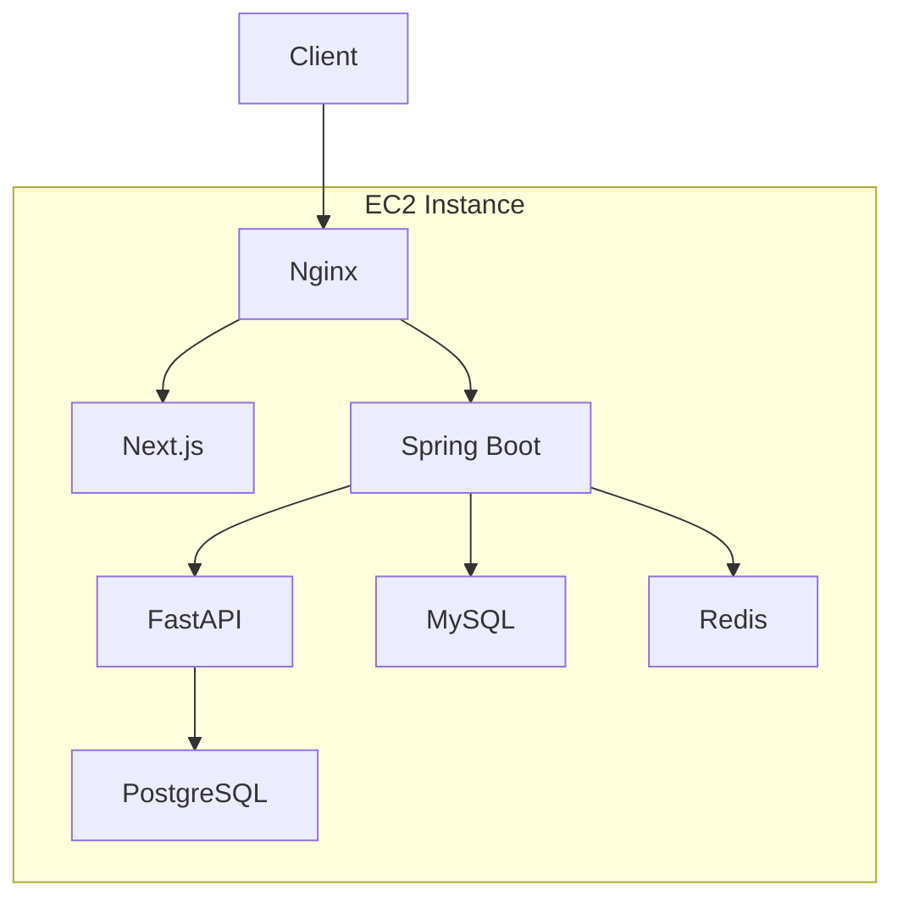
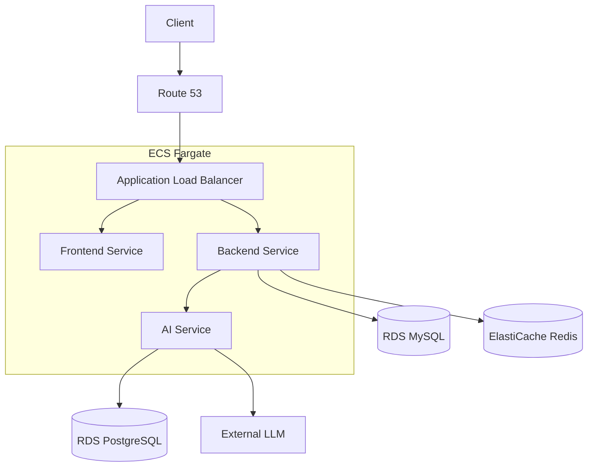
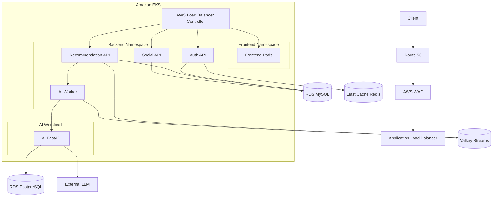
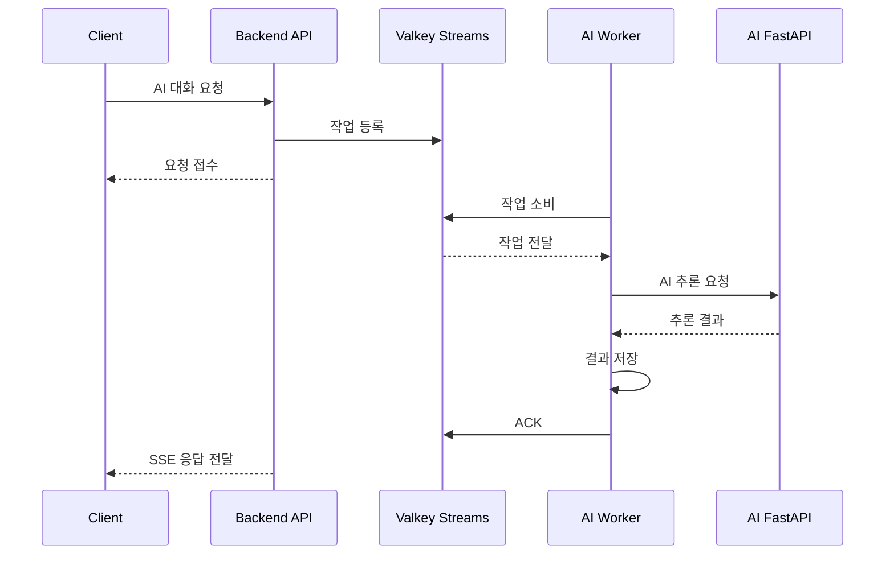

<!--
NeedU README 템플릿

1. 이 파일 내용을 각 저장소의 README.md로 복사합니다.
2. 공통 영역(COMMON 시작~끝 주석 사이)은 네 저장소가 똑같아야 합니다. 고치지 말고 그대로 두세요.
   바꿀 일이 생기면 한 저장소에서 고친 뒤 나머지 저장소에 같은 내용을 복사합니다.
3. 헤더 캐릭터 GIF를 저장소에 넣습니다. 경로가 정확히 같아야 합니다.
   KTB4-4th-BE의 .github/assets/needu-character.gif 를 내 저장소의 같은 경로로 복사
4. 파트 영역(PART 시작~끝 주석 사이)만 내 스택에 맞게 작성합니다.
   - {{...}} 빈칸을 모두 실제 값으로 바꿉니다.
   - "안내:"로 시작하는 주석은 다 쓴 뒤 지워도 됩니다. COMMON/PART 경계 주석은 남겨 주세요.
   - 해당 없는 섹션은 통째로 지웁니다. 빈칸을 남겨 두지 않습니다.
   - 실제 키·비밀번호·토큰은 README에 넣지 않습니다.
5. 작성 예시는 KTB4-4th-BE의 README.md를 참고하세요.
6. 이 사용법 주석은 마지막에 지웁니다.
-->

<!-- COMMON:START -->
<div align="center">

<br>

<h1>
  NeedU
  
</h1>

<h3>대화 몇 마디로 알아내는<br>나와 친구의 진짜 니즈</h3>

<p>
  <sub>AI 취향 분석&nbsp;&nbsp;·&nbsp;&nbsp;맞춤 상품 추천&nbsp;&nbsp;·&nbsp;&nbsp;친구 선물 추천&nbsp;&nbsp;·&nbsp;&nbsp;익명 채팅</sub>
</p>

<br>

<a href="https://needu.gift"></a>
&nbsp;
<a href="https://github.com/100-hours-a-week/KTB4-4th-wiki"></a>

<br>

</div>

## 서비스 소개

<p align="center">
  <sub><b>WHY NEEDU</b></sub>
</p>

<h3 align="center">
  내가 무엇을 좋아하는지,<br>
  친구가 무엇을 원하는지 모를 때
</h3>

<p align="center">
  NeedU는 AI와 나누는 짧은 대화에서 <b>나도 몰랐던 취향과 관심사</b>를 발견하고,<br>
  그 취향에 꼭 맞는 <b>나를 위한 상품</b>과 <b>친구를 위한 선물</b>을 찾아 줍니다.
</p>

<p align="center">
  <sub>취향을 말로 설명하기 어려운 사람도, 선물 앞에서 막막한 사람도 대화 몇 마디면 충분합니다.</sub>
</p>

<br>

<div align="center">
<table>
  <tr>
    <td align="center" width="180"><kbd>01</kbd><br><br><b>AI 취향 대화</b><br><sub>몰랐던 내 취향을<br>대화로 발견해요</sub></td>
    <td align="center" width="180"><kbd>02</kbd><br><br><b>맞춤 상품 추천</b><br><sub>내 취향에 맞는<br>상품만 골라요</sub></td>
    <td align="center" width="180"><kbd>03</kbd><br><br><b>친구 선물 추천</b><br><sub>친구 취향으로<br>선물을 찾아요</sub></td>
    <td align="center" width="180"><kbd>04</kbd><br><br><b>익명 채팅</b><br><sub>정체를 숨기고<br>슬쩍 물어봐요</sub></td>
    <td align="center" width="180"><kbd>05</kbd><br><br><b>알림</b><br><sub>생일·콕 찌르기를<br>놓치지 않아요</sub></td>
  </tr>
</table>
</div>

<details>
<summary><b>기능 자세히 보기</b></summary>
<br>
<div align="center">

| 기능 | 설명 |
| :---: | :---: |
| **AI 취향 대화** | AI와 편하게 이야기하면 답변이 실시간으로 이어지고,<br>대화가 끝나면 분석 결과를 확인하고 직접 다듬을 수 있습니다. |
| **맞춤 상품 추천** | 확정한 취향을 바탕으로 상품을 추천합니다.<br>가격과 카테고리로 원하는 상품만 골라 볼 수 있습니다. |
| **친구 선물 추천** | NeedU에 가입한 카카오 친구의 취향 요약을 보고,<br>그 친구에게 어울리는 선물을 추천받습니다. |
| **익명 채팅** | 친구에게 직접 묻기 어려울 때, 정체를 숨긴 채<br>대화하며 원하는 선물을 자연스럽게 물어봅니다. |
| **알림** | 친구의 생일, 친구 가입, 콕 찌르기, 구매 확인 소식을<br>앱 알림과 웹 푸시로 받습니다. |

</div>
</details>

### 팀 · 저장소

<div align="center">
<table>
  <tr>
    <th width="200">BE</th>
    <th width="200">AI</th>
    <th width="200">FE</th>
    <th width="200">CLOUD</th>
  </tr>
  <tr>
    <td align="center"><a href="https://github.com/jynoh00"></a> <a href="https://github.com/FinnPing1741"></a><br><sub><a href="https://github.com/jynoh00">jynoh00</a> · <a href="https://github.com/FinnPing1741">FinnPing1741</a></sub></td>
    <td align="center"><a href="https://github.com/seoddhh"></a><br><sub><a href="https://github.com/seoddhh">seoddhh</a></sub></td>
    <td align="center"><a href="https://github.com/juiuj"></a><br><sub><a href="https://github.com/juiuj">juiuj</a></sub></td>
    <td align="center"><a href="https://github.com/sodam2z"></a> <a href="https://github.com/hyo-lin"></a><br><sub><a href="https://github.com/sodam2z">sodam2z</a> · <a href="https://github.com/hyo-lin">hyo-lin</a></sub></td>
  </tr>
  <tr>
    <td align="center">비즈니스 로직 · API</td>
    <td align="center">대화 · 취향 분석 · 추천</td>
    <td align="center">화면 · 클라이언트 상태</td>
    <td align="center">인프라 · 배포 · 관측성</td>
  </tr>
  <tr>
    <td align="center"><a href="https://github.com/100-hours-a-week/KTB4-4th-BE"><code>KTB4-4th-BE</code></a></td>
    <td align="center"><a href="https://github.com/100-hours-a-week/KTB4-4th-AI"><code>KTB4-4th-AI</code></a></td>
    <td align="center"><a href="https://github.com/100-hours-a-week/KTB4-4th-FE"><code>KTB4-4th-FE</code></a></td>
    <td align="center"><a href="https://github.com/100-hours-a-week/KTB4-4th-CLOUD"><code>KTB4-4th-CLOUD</code></a></td>
  </tr>
</table>
</div>

<!-- COMMON:END -->

<br/>

---

<!-- PART:START -->

<div align="center">

# NeedU Cloud

**안정적인 서비스 운영을 위한 AWS 클라우드 인프라 구축 및 자동화**

EC2 기반 단일 서버에서 ECS Fargate, EKS로 아키텍처를 발전시키며  
인프라 프로비저닝, CI/CD, 데이터 마이그레이션, 모니터링 및 장애 대응을 담당합니다.


</div>

<br/>

## 책임 범위

**담당**

- AWS 기반 VPC, EC2, ECS Fargate, EKS, ALB, RDS, ElastiCache 인프라 설계 및 운영
- Terraform을 활용한 Infrastructure as Code(IaC) 구성 및 환경별 리소스 관리
- GitHub Actions, ECR, Helm, Argo CD 기반 CI/CD 및 GitOps 배포 자동화
- EC2 → ECS → EKS 아키텍처 전환 및 데이터 마이그레이션
- Prometheus, Grafana, CloudWatch, ADOT 기반 모니터링
- k6 부하 테스트 및 장애 복구 시나리오 검증
- AWS WAF, IAM, OIDC, External Secrets 기반 보안 및 권한 관리

**비담당**

- 서비스 비즈니스 로직 및 API 구현 → [Backend](https://github.com/100-hours-a-week/KTB4-4th-BE)
- AI 모델 개발 및 추천 알고리즘 → [AI](https://github.com/100-hours-a-week/KTB4-4th-AI)
- 사용자 인터페이스 및 클라이언트 로직 → [Frontend](https://github.com/100-hours-a-week/KTB4-4th-FE)

## 기술 스택

| 분류 | 기술 | 사용 목적 |
| --- | --- | --- |
| Cloud | AWS | 클라우드 인프라 구축 및 운영 |
| IaC | Terraform | 인프라 코드화 및 환경별 리소스 관리 |
| Compute | EC2, ECS Fargate, EKS | 서비스 실행 환경 및 컨테이너 오케스트레이션 |
| Container | Docker, ECR | 컨테이너 이미지 빌드 및 저장 |
| Networking | VPC, ALB, Route 53, NAT Gateway | 네트워크 격리 및 트래픽 라우팅 |
| Database | RDS MySQL, RDS PostgreSQL | 관계형 데이터 저장 |
| Cache / Queue | Redis, Valkey Streams | 캐싱, 세션 및 비동기 작업 처리 |
| CI/CD | GitHub Actions, Argo CD, Helm | 이미지 배포 및 GitOps 자동화 |
| Security | IAM, OIDC, WAF, SSM, External Secrets | 권한 제어, 보안 정책 및 Secret 관리 |
| Monitoring | CloudWatch, Prometheus, Grafana, ADOT, AMP | 메트릭 수집 및 관측성 확보 |
| Scaling | HPA, KEDA, Cluster Autoscaler | Pod 및 Node 자동 확장 |
| Testing | k6 | 성능 및 부하 테스트 |
| Migration | AWS DMS | 데이터베이스 마이그레이션 및 정합성 검증 |

## 아키텍처

NeedU는 서비스 규모와 운영 요구사항에 따라 세 단계로 인프라를 발전시켰습니다.

| 구분 | V1 | V2 | V3 |
| --- | --- | --- | --- |
| Compute | EC2 | ECS Fargate | EKS |
| Architecture | 단일 서버 | 서비스별 컨테이너 분리 | Kubernetes 기반 워크로드 분리 |
| Deployment | Docker 기반 배포 | GitHub Actions + ECR | GitHub Actions + Argo CD |
| Database | EC2 내부 DB | RDS | RDS |
| Cache / Queue | Redis | ElastiCache Redis | Redis + Valkey Streams |
| Scaling | 수직 확장 중심 | ECS Service 확장 | HPA, KEDA, Cluster Autoscaler |
| Monitoring | 서버 중심 모니터링 | CloudWatch | Prometheus, Grafana, ADOT |

### V1 — EC2 기반 단일 서버



초기에는 단일 EC2 인스턴스에서 Frontend, Backend, AI, Database를 함께 운영했습니다.

구성이 단순하고 비용이 낮다는 장점이 있었지만, 부하 증가 시 여러 서비스가 동일한 서버 리소스를 공유하는 문제가 발생했습니다.

### V2 — ECS Fargate 기반 서비스 분리



- Frontend, Backend, AI를 독립적인 ECS Service로 분리
- ALB 기반 HTTPS 및 Path Routing 적용
- MySQL과 PostgreSQL을 RDS로 이전
- Terraform 기반 인프라 프로비저닝
- GitHub Actions와 ECR을 활용한 이미지 배포 자동화
- Dev, Staging, Production 환경 분리

### V3 — EKS 기반 Kubernetes 아키텍처



> 위 다이어그램은 주요 인프라와 서비스 간 관계를 단순화한 구성도입니다. AI Worker의 실제 작업 전달은 Valkey Streams를 통해 이루어집니다.

**설계 원칙**

- **워크로드 분리** — API와 AI Worker를 분리하여 추론 작업이 API 처리에 미치는 영향을 줄입니다.
- **선언적 인프라 관리** — Terraform과 GitOps로 인프라 및 Kubernetes 리소스 변경 이력을 관리합니다.
- **독립적인 확장** — HPA, KEDA, Cluster Autoscaler로 워크로드 특성에 맞게 확장합니다.
- **가용성 확보** — 다중 AZ 및 복수 Replica를 활용해 단일 장애 지점의 영향을 줄입니다.
- **관측성 확보** — 메트릭과 대시보드를 통해 성능 저하 및 장애 상황을 분석합니다.

### AI 비동기 작업 처리 흐름



AI 요청 처리와 실제 추론 작업을 분리하여 장시간 실행되는 AI 작업이 API 요청 처리에 미치는 영향을 줄이도록 설계했습니다.

## 시작하기

**필요 도구**

- AWS CLI
- Terraform
- kubectl
- Helm
- Docker
- GitHub CLI

### 저장소 복제

```bash
git clone https://github.com/100-hours-a-week/KTB4-4th-CLOUD.git

cd KTB4-4th-CLOUD
```

### AWS 인증

```bash
aws sso login --profile needu-v2

aws sts get-caller-identity --profile needu-v2
```

실제 인프라 작업 전에는 대상 환경과 AWS 계정, Terraform Workspace 및 State를 확인해야 합니다.

### Terraform 검증

```bash
terraform fmt -check -recursive
terraform validate
```

`terraform validate`는 Terraform 구성이 초기화된 디렉터리에서 실행해야 합니다.

운영 환경에 대한 `terraform apply` 및 `terraform destroy`는 변경 계획을 검토한 뒤 수행합니다.

## 인프라 구성

| 구성 요소 | 설명 |
| --- | --- |
| VPC | 서비스 네트워크 및 Subnet 구성 |
| ALB | HTTPS 트래픽 분산 및 라우팅 |
| ECS Fargate | V2 컨테이너 실행 환경 |
| EKS | V3 Kubernetes 클러스터 |
| RDS MySQL | 사용자 및 서비스 데이터 |
| RDS PostgreSQL | AI 및 벡터 데이터 |
| ElastiCache Redis | 캐싱 및 서비스 데이터 처리 |
| ElastiCache Valkey | AI 비동기 작업 Stream |
| Route 53 | 서비스 도메인 관리 |
| AWS WAF | 악성 요청 및 비정상 트래픽 대응 |
| AMP | Prometheus 메트릭 저장 |
| CloudWatch | 로그 및 AWS 리소스 모니터링 |

## 테스트

### 주요 검증 항목

| 종류 | 검증 대상 |
| --- | --- |
| Infrastructure | Terraform 정적 검증 및 실행 계획 |
| Deployment | GitHub Actions, ECR, Argo CD 배포 |
| Health Check | Startup, Readiness, Liveness Probe |
| Load Test | k6 기반 API 부하 및 응답 지연 |
| Scaling | HPA, KEDA, Cluster Autoscaler |
| Failure Recovery | Worker 종료 및 작업 재처리 |
| Migration | AWS DMS 데이터 정합성 |
| Observability | Prometheus 및 Grafana 메트릭 수집 |

### 부하 테스트

V1에서는 단일 서버의 처리 한계를 확인하고, V2에서는 서비스 분리 이후 API 처리 성능을 검증했습니다.

V3에서는 API 처리량뿐 아니라 AI 비동기 작업 적체, Worker 장애 복구, 자동 확장 및 배포 중 연결 안정성을 검증 대상으로 설정했습니다.

**V3 주요 테스트 시나리오**

1. AI 추론 지연 및 Queue Lag 증가
2. AI Worker 종료 시 작업 재처리
3. Worker 분리 전후 API 응답 안정성 비교
4. 급증 트래픽에 대한 Pod 및 Node 확장
5. 배포 중 SSE 및 WebSocket 연결 안정성

## 배포

### CI/CD 및 GitOps


- **CI** — 애플리케이션 변경 시 Docker 이미지 빌드 및 ECR Push
- **GitOps** — 이미지 Digest 변경을 GitOps 저장소 PR로 관리
- **Dev** — GitOps 변경 병합 후 Argo CD 자동 동기화
- **Production** — 승인된 이미지에 대해 수동 승격 절차 적용
- **Rollback** — 이전 정상 이미지 Digest 및 GitOps 선언 상태로 복구
- **Monitoring** — Grafana, Prometheus, CloudWatch를 통한 배포 상태 확인

V3 Dev 환경은 구축 및 검증 이후 리소스 정리를 완료했습니다.

## 기술적 결정

### 1. 단일 EC2에서 ECS Fargate로 전환

V1에서는 Frontend, Backend, AI 및 데이터베이스가 단일 EC2 리소스를 공유했습니다.

부하 테스트를 통해 서버 리소스 경합과 처리량 한계를 확인한 뒤 ECS Fargate 기반으로 서비스를 분리했습니다.

이를 통해 서비스별 실행 환경을 독립적으로 관리하고, RDS를 통한 데이터 계층 분리를 진행했습니다.

### 2. 데이터 마이그레이션 자동화

EC2 내부 데이터베이스를 RDS로 이전하면서 서비스 중단과 데이터 유실을 최소화하는 것을 목표로 했습니다.

사전 검증(Preflight), 쓰기 제한, 데이터 동기화 확인, 트래픽 전환(Cutover)을 절차화했습니다.

| 지표 | 검증 결과 |
| --- | ---: |
| Preflight | 1분 17초 |
| Cutover | 2분 37초 |
| RPO | **0** |
| DMS 검증 테이블 | 7개 |
| Validation Failed Records | **0건** |
| Resync Failed Rows | **0건** |

### 3. ECS에서 EKS로 전환

V2에서는 ECS Service 단위로 애플리케이션을 관리했으나, V3에서는 Kubernetes를 통해 서비스별 배포 및 확장 정책을 세분화했습니다.

- Backend 단일 이미지를 여러 Deployment로 분리
- Helm과 Argo CD 기반 선언적 배포
- HPA 기반 API Pod 확장
- KEDA 기반 AI Worker 확장 설계
- Cluster Autoscaler 기반 Node 확장
- Namespace 및 RBAC 기반 리소스 분리
- Startup, Readiness, Liveness Probe 구성

### 4. Redis와 Valkey Streams 역할 분리

로그인 및 일반 서비스 데이터 처리와 AI 비동기 작업이 동일한 저장소 리소스를 공유하지 않도록 구성했습니다.

AI 작업은 Valkey Streams에 등록하고 별도 Worker가 소비하도록 설계했습니다.

이를 통해 API 요청 처리와 AI 추론 작업을 분리하고, 작업 적체량을 기준으로 Worker를 독립적으로 확장할 수 있는 구조를 마련했습니다.

## 협업 규칙

| 항목 | 규칙 |
| --- | --- |
| 브랜치 | 기능 및 작업 단위로 브랜치 생성 |
| 커밋 | 변경 목적이 드러나는 메시지 작성 |
| PR | 변경 배경, 주요 변경 사항, 검증 결과 작성 |
| Terraform | Plan 확인 후 Apply |
| Production | 변경 영향 및 롤백 방안 검토 |
| GitOps | 이미지 변경을 PR로 관리하고 Argo CD 동기화 상태 확인 |
| Secret | 민감 정보는 Git에 커밋하지 않고 AWS Secret 관리 서비스 사용 |

## 문제 해결

<details>
<summary><b>Argo CD 배포가 실패합니다</b></summary>

<br/>

**확인 항목**

- Application Sync 및 Health 상태
- GitOps Repository의 이미지 Digest
- ECR 이미지 존재 여부
- Kubernetes Event 및 Pod 상태
- ExternalSecret 동기화 여부

```bash
kubectl get pods -A

kubectl get events -A --sort-by=.lastTimestamp
```

</details>

<details>
<summary><b>External Secrets 동기화가 실패합니다</b></summary>

<br/>

AWS IAM Role에 필요한 권한이 누락되면 Secret 동기화 또는 관련 Terraform 변경이 실패할 수 있습니다.

실제 Production 구성 과정에서 `iam:PutRolePolicy` 권한 부족 문제가 발생해 Bootstrap IAM 정책을 수정한 이력이 있습니다.

**확인 항목**

- IAM Role 및 정책
- ServiceAccount와 IAM 연결
- SecretStore 상태
- ExternalSecret 상태
- SSM Parameter 및 Secrets Manager 경로

</details>

<details>
<summary><b>ALB를 통한 WebSocket 연결이 실패합니다</b></summary>

<br/>

V2 Dev 환경에서 STOMP 연결 중 504 오류가 발생한 사례가 있었습니다.

ALB Listener Rule 및 요청 라우팅 구성을 확인하고 규칙을 추가하여 해결했습니다.

**확인 항목**

- ALB Listener Rule
- Target Group Health
- Backend Service Port
- WebSocket 요청 경로
- ALB 및 애플리케이션 로그

</details>

## 문서 · 문의

- [Cloud Repository](https://github.com/100-hours-a-week/KTB4-4th-CLOUD)
- [GitOps Repository](https://github.com/100-hours-a-week/KTB4-4th-GITOPS)
- [Team Wiki](https://github.com/100-hours-a-week/KTB4-4th-wiki)
- [GitHub Issues](https://github.com/100-hours-a-week/KTB4-4th-CLOUD/issues)

<!-- PART:END -->
