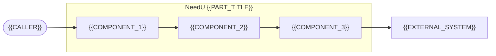
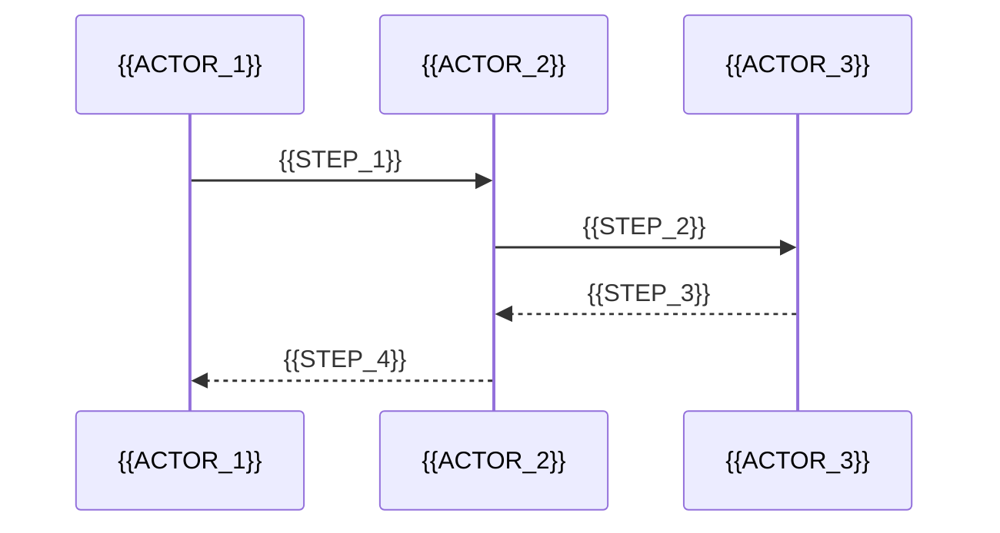
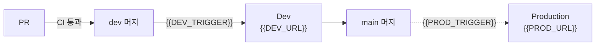

<!--
NeedU README 템플릿

1. 이 파일 내용을 각 저장소의 README.md로 복사합니다.
2. 공통 영역(COMMON 시작~끝 주석 사이)은 네 저장소가 똑같아야 합니다. 고치지 말고 그대로 두세요.
   바꿀 일이 생기면 한 저장소에서 고친 뒤 나머지 저장소에 같은 내용을 복사합니다.
3. 헤더 캐릭터 GIF를 저장소에 넣습니다. 경로가 정확히 같아야 합니다.
   KTB4-4th-BE의 .github/assets/needu-character.gif 를 내 저장소의 같은 경로로 복사
4. 파트 영역(PART 시작~끝 주석 사이)만 내 스택에 맞게 작성합니다.
   - {{...}} 빈칸을 모두 실제 값으로 바꿉니다.
   - "안내:"로 시작하는 주석은 다 쓴 뒤 지워도 됩니다. COMMON/PART 경계 주석은 남겨 주세요.
   - 해당 없는 섹션은 통째로 지웁니다. 빈칸을 남겨 두지 않습니다.
   - 실제 키·비밀번호·토큰은 README에 넣지 않습니다.
5. 작성 예시는 KTB4-4th-BE의 README.md를 참고하세요.
6. 이 사용법 주석은 마지막에 지웁니다.
-->

<!-- COMMON:START -->
<div align="center">

<br>

<h1>
  NeedU
  
</h1>

<h3>대화 몇 마디로 알아내는<br>나와 친구의 진짜 니즈</h3>

<p>
  <sub>AI 취향 분석&nbsp;&nbsp;·&nbsp;&nbsp;맞춤 상품 추천&nbsp;&nbsp;·&nbsp;&nbsp;친구 선물 추천&nbsp;&nbsp;·&nbsp;&nbsp;익명 채팅</sub>
</p>

<br>

<a href="https://needu.gift"></a>
&nbsp;
<a href="https://github.com/100-hours-a-week/KTB4-4th-wiki"></a>

<br>

</div>

## 서비스 소개

<p align="center">
  <sub><b>WHY NEEDU</b></sub>
</p>

<h3 align="center">
  내가 무엇을 좋아하는지,<br>
  친구가 무엇을 원하는지 모를 때
</h3>

<p align="center">
  NeedU는 AI와 나누는 짧은 대화에서 <b>나도 몰랐던 취향과 관심사</b>를 발견하고,<br>
  그 취향에 꼭 맞는 <b>나를 위한 상품</b>과 <b>친구를 위한 선물</b>을 찾아 줍니다.
</p>

<p align="center">
  <sub>취향을 말로 설명하기 어려운 사람도, 선물 앞에서 막막한 사람도 대화 몇 마디면 충분합니다.</sub>
</p>

<br>

<div align="center">
<table>
  <tr>
    <td align="center" width="180"><kbd>01</kbd><br><br><b>AI 취향 대화</b><br><sub>몰랐던 내 취향을<br>대화로 발견해요</sub></td>
    <td align="center" width="180"><kbd>02</kbd><br><br><b>맞춤 상품 추천</b><br><sub>내 취향에 맞는<br>상품만 골라요</sub></td>
    <td align="center" width="180"><kbd>03</kbd><br><br><b>친구 선물 추천</b><br><sub>친구 취향으로<br>선물을 찾아요</sub></td>
    <td align="center" width="180"><kbd>04</kbd><br><br><b>익명 채팅</b><br><sub>정체를 숨기고<br>슬쩍 물어봐요</sub></td>
    <td align="center" width="180"><kbd>05</kbd><br><br><b>알림</b><br><sub>생일·콕 찌르기를<br>놓치지 않아요</sub></td>
  </tr>
</table>
</div>

<details>
<summary><b>기능 자세히 보기</b></summary>
<br>
<div align="center">

| 기능 | 설명 |
| :---: | :---: |
| **AI 취향 대화** | AI와 편하게 이야기하면 답변이 실시간으로 이어지고,<br>대화가 끝나면 분석 결과를 확인하고 직접 다듬을 수 있습니다. |
| **맞춤 상품 추천** | 확정한 취향을 바탕으로 상품을 추천합니다.<br>가격과 카테고리로 원하는 상품만 골라 볼 수 있습니다. |
| **친구 선물 추천** | NeedU에 가입한 카카오 친구의 취향 요약을 보고,<br>그 친구에게 어울리는 선물을 추천받습니다. |
| **익명 채팅** | 친구에게 직접 묻기 어려울 때, 정체를 숨긴 채<br>대화하며 원하는 선물을 자연스럽게 물어봅니다. |
| **알림** | 친구의 생일, 친구 가입, 콕 찌르기, 구매 확인 소식을<br>앱 알림과 웹 푸시로 받습니다. |

</div>
</details>

### 팀 · 저장소

<div align="center">
<table>
  <tr>
    <th width="200">BE</th>
    <th width="200">AI</th>
    <th width="200">FE</th>
    <th width="200">CLOUD</th>
  </tr>
  <tr>
    <td align="center"><a href="https://github.com/jynoh00"></a> <a href="https://github.com/FinnPing1741"></a><br><sub><a href="https://github.com/jynoh00">jynoh00</a> · <a href="https://github.com/FinnPing1741">FinnPing1741</a></sub></td>
    <td align="center"><a href="https://github.com/seoddhh"></a><br><sub><a href="https://github.com/seoddhh">seoddhh</a></sub></td>
    <td align="center"><a href="https://github.com/juiuj"></a><br><sub><a href="https://github.com/juiuj">juiuj</a></sub></td>
    <td align="center"><a href="https://github.com/sodam2z"></a> <a href="https://github.com/hyo-lin"></a><br><sub><a href="https://github.com/sodam2z">sodam2z</a> · <a href="https://github.com/hyo-lin">hyo-lin</a></sub></td>
  </tr>
  <tr>
    <td align="center">비즈니스 로직 · API</td>
    <td align="center">대화 · 취향 분석 · 추천</td>
    <td align="center">화면 · 클라이언트 상태</td>
    <td align="center">인프라 · 배포 · 관측성</td>
  </tr>
  <tr>
    <td align="center"><a href="https://github.com/100-hours-a-week/KTB4-4th-BE"><code>KTB4-4th-BE</code></a></td>
    <td align="center"><a href="https://github.com/100-hours-a-week/KTB4-4th-AI"><code>KTB4-4th-AI</code></a></td>
    <td align="center"><a href="https://github.com/100-hours-a-week/KTB4-4th-FE"><code>KTB4-4th-FE</code></a></td>
    <td align="center"><a href="https://github.com/100-hours-a-week/KTB4-4th-CLOUD"><code>KTB4-4th-CLOUD</code></a></td>
  </tr>
</table>
</div>

<!-- COMMON:END -->

<br/>

---

<!-- PART:START -->

<div align="center">

<h1>NeedU {{PART_TITLE}}</h1>

<!-- 안내: PART_TITLE 예) Backend · AI · Frontend · Cloud -->

<p>{{ONE_LINE_ROLE}}</p>

<!-- 안내: 이 저장소가 하는 일을 한 줄로. 예) 인증, 사용자·친구·상품, AI 대화 중계, 알림을 담당하는 Spring Boot 서버 -->

<!-- 안내: GitHub Actions 상태 배지. 워크플로가 없으면 이 두 줄을 지웁니다. -->
[](https://github.com/100-hours-a-week/{{REPO_NAME}}/actions/workflows/{{WORKFLOW_FILE}})

<!-- 안내: 주요 기술 배지 4~8개. 로고 이름과 색은 https://simpleicons.org 에서 찾습니다. 공백은 _ 로 씁니다. -->


</div>

<br/>

## 책임 범위

<!-- 안내: 하는 일과 하지 않는 일을 나눠, 다른 파트와의 경계를 분명히 합니다. 비담당 항목에는 담당 저장소 링크를 답니다. -->

**담당**

- {{RESPONSIBILITY_1}}
- {{RESPONSIBILITY_2}}
- {{RESPONSIBILITY_3}}

**비담당**

- {{OUT_OF_SCOPE_1}} → [{{OWNER_PART_1}}](https://github.com/100-hours-a-week/KTB4-4th-{{OWNER_PART_1}})
- {{OUT_OF_SCOPE_2}} → [{{OWNER_PART_2}}](https://github.com/100-hours-a-week/KTB4-4th-{{OWNER_PART_2}})

## 기술 스택

<!-- 안내: 이름만 나열하지 말고, 버전과 쓰는 이유를 함께 적습니다. 분류는 스택에 맞게 바꿔도 됩니다. -->

| 분류 | 기술 | 사용 목적 |
| --- | --- | --- |
| Language | {{LANGUAGE_AND_VERSION}} | {{PURPOSE}} |
| Framework | {{FRAMEWORK_AND_VERSION}} | {{PURPOSE}} |
| {{CATEGORY}} | {{TECH}} | {{PURPOSE}} |
| Test | {{TEST_TECH}} | {{PURPOSE}} |
| Deploy | {{DEPLOY_TECH}} | {{PURPOSE}} |

## 아키텍처

<!-- 안내: 내 저장소 안의 구성 요소와 바깥 시스템(다른 파트, 외부 API, DB)의 호출 방향을 그립니다. GitHub에서 Mermaid로 그려집니다. -->



**설계 원칙**

<!-- 안내: "무엇을 / 왜" 형식으로 2~4개. 예) 다중 인스턴스 전제 — 락과 이벤트 전달은 Redis로 처리합니다. -->

- **{{PRINCIPLE_1}}** — {{PRINCIPLE_1_REASON}}
- **{{PRINCIPLE_2}}** — {{PRINCIPLE_2_REASON}}
- **{{PRINCIPLE_3}}** — {{PRINCIPLE_3_REASON}}

### {{CORE_FLOW_TITLE}}

<!-- 안내: 선택 섹션. 가장 중요한 흐름 하나를 시퀀스 다이어그램으로 보여 줍니다. 없으면 이 섹션을 지웁니다.
     예) BE: AI 대화 메시지 흐름 / AI: 취향 분석 파이프라인 / FE: 로그인 흐름 / CLOUD: 요청이 서버까지 가는 경로 -->



## 시작하기

**필요 도구** — {{TOOL_1}} · {{TOOL_2}} · {{TOOL_3}}

```bash
git clone https://github.com/100-hours-a-week/{{REPO_NAME}}.git
cd {{REPO_NAME}}

{{SETUP_COMMANDS}}
{{RUN_COMMAND}}
```

`{{HEALTHCHECK}}`이면 준비 완료입니다.

<!-- 안내: 실행 확인 방법. 예) http://localhost:3000 이 열리면 / terraform plan 이 오류 없이 끝나면 -->

<details>
<summary><b>환경 변수 목록</b></summary>

<br/>

전체 목록은 [`.env.example`](./.env.example)에 있습니다. 실제 키는 README와 `.env.example`에 넣지 않습니다.

| 변수 | 필수 | 설명 |
| --- | :---: | --- |
| `{{ENV_NAME_1}}` | ✓ | {{ENV_DESCRIPTION_1}} |
| `{{ENV_NAME_2}}` | | {{ENV_DESCRIPTION_2}} |

</details>

## {{INTERFACE_TITLE}}

<!-- 안내: 다른 파트가 내 저장소와 맞물리는 지점을 요약하고, 자세한 명세는 링크합니다.
     섹션 이름 예) BE: API / AI: API 명세 / FE: 화면 구성 / CLOUD: 인프라 구성 -->

| 구분 | 내용 |
| --- | --- |
| {{INTERFACE_1}} | {{INTERFACE_1_DESCRIPTION}} |
| {{INTERFACE_2}} | {{INTERFACE_2_DESCRIPTION}} |

## 디렉터리 구조

<!-- 안내: 최상위 폴더만, 한 줄 설명과 함께. -->

```text
{{ROOT_DIRECTORY}}
├── {{DIRECTORY_1}}     {{DIRECTORY_1_DESCRIPTION}}
├── {{DIRECTORY_2}}     {{DIRECTORY_2_DESCRIPTION}}
└── {{DIRECTORY_3}}     {{DIRECTORY_3_DESCRIPTION}}
```

## 테스트

```bash
{{TEST_COMMAND}}     # {{TEST_COMMAND_DESCRIPTION}}
{{BUILD_COMMAND}}
```

| 종류 | 대상 |
| --- | --- |
| {{TEST_TYPE_1}} | {{TEST_TARGET_1}} |
| {{TEST_TYPE_2}} | {{TEST_TARGET_2}} |

{{PR_CHECK_RULE}}

<!-- 안내: PR이 통과해야 하는 검사. 예) PR은 test·build를 통과해야 합니다. -->

## 배포

<!-- 안내: 브랜치가 어느 환경으로 어떻게 배포되는지 그립니다. 자동은 실선, 수동은 점선(-.->)으로 구분합니다. -->



- **Dev** — {{DEV_DEPLOY_DESCRIPTION}}
- **Production** — {{PROD_DEPLOY_DESCRIPTION}}
- **롤백** — {{ROLLBACK_DESCRIPTION}}
- **모니터링** — {{MONITORING_DESCRIPTION}}

## 기술적 결정

<!-- 안내: 결정마다 "문제 → 선택 → 결과" 순서로 짧게 씁니다. 수치가 있으면 표로 보여 줍니다. 2~4개 권장. -->

### {{DECISION_1_TITLE}}

{{DECISION_1_PROBLEM_AND_CHOICE}}

| 지표 | 이전 | 이후 |
| --- | ---: | ---: |
| {{METRIC_1}} | {{BEFORE_1}} | **{{AFTER_1}}** |
| {{METRIC_2}} | {{BEFORE_2}} | **{{AFTER_2}}** |

<sub>{{MEASUREMENT_CONDITION}}</sub>

### {{DECISION_2_TITLE}}

{{DECISION_2_PROBLEM_AND_CHOICE}}

## 협업 규칙

| 항목 | 규칙 |
| --- | --- |
| 브랜치 | {{BRANCH_RULE}} |
| 커밋 | {{COMMIT_RULE}} |
| PR | {{PR_RULE}} |

## 문제 해결

<!-- 안내: 처음 세팅하는 팀원이 실제로 겪은 문제 위주로. 제목은 증상(에러 메시지), 본문은 원인과 해결 방법. -->

<details>
<summary><code>{{ERROR_MESSAGE_1}}</code>이 발생합니다</summary>

<br/>

{{CAUSE_AND_SOLUTION_1}}

</details>

<details>
<summary>{{SYMPTOM_2}}</summary>

<br/>

{{CAUSE_AND_SOLUTION_2}}

</details>

## 문서 · 문의

- [{{DOC_1_NAME}}]({{DOC_1_URL}}) · [팀 위키](https://github.com/100-hours-a-week/KTB4-4th-wiki)
- 이슈: [GitHub Issues](https://github.com/100-hours-a-week/{{REPO_NAME}}/issues) · 팀 채널: {{TEAM_CHANNEL}}
- 라이선스: {{LICENSE}}

<!-- PART:END -->
